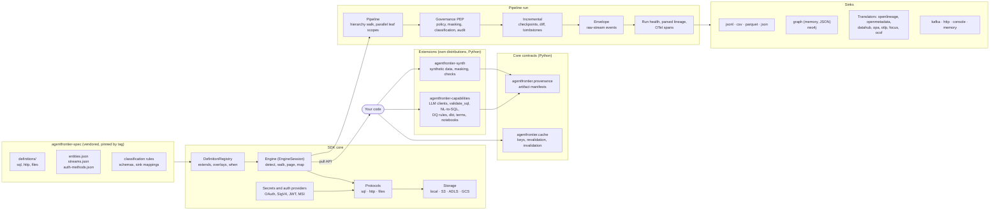

# AgentFrontier architecture

AgentFrontier is a configuration-driven data source SDK. It reads what a data source knows about itself (structure,
lineage, governance, usage, business context) and, on request, sample rows and read-only queries. Whatever the source,
it returns one canonical record model and can deliver it to files, graphs, other catalogs or streams.

This document describes how the SDK is built: the parts, how a run flows through them, where the extension points
are, and how the Python and Java editions stay identical. [features.md](features.md) lists what it can do today.

## 1. Principles

* **A source is configuration, not code.** Each data source is a JSON *definition*. One engine per access *protocol*
  (`sql`, `http`, `files`) runs it. Supporting another database or API means writing a JSON file. A new protocol is
  the only thing that needs code.
* **One contract, several editions.** The definitions, the entity model and the rules live in a language-neutral
  spec. The Python and Java editions implement it and must produce byte-identical output for the same source, up to
  the raw-stream layer.
* **SDK only.** AgentFrontier runs in the caller's process. It needs no service, database or UI of its own, and any
  state goes through an interface the caller controls (checkpoint store, graph store, secret resolver, policy
  decision point). UIs, approvals, schedulers, hosted tenancy and queues belong to products such as Avero and Evia.
  The boundary rule is in `common-docs/AGENTFRONTIER-PLAN.md` §2.1.
* **Read-only by construction.** Catalog SQL comes from definitions, with values always bound. Ad hoc queries pass a
  guard and run in read-only sessions. Secrets are references that are resolved only when a session opens.
* **Deterministic.** The same input gives the same records, the same `eventId`s and the same translated documents.
  This makes deduplication, replay and cross-edition tests possible.
* **Standard library first.** The core Python package has no required dependencies. Drivers and heavy libraries
  (pyarrow, sqlglot, kafka-python, neo4j, OpenTelemetry) are optional extras.

## 2. The big picture

The cache and provenance contracts sit beside the engine: products build the cache store, and the extensions write
a provenance manifest for every artifact they generate.

The caller uses the SDK in one of two ways:

* **Pull** (`AgentFrontier.open` → `EngineSession`): containers, paged datasets, records of an entity for a batch of
  datasets, samples and queries. This suits services that keep their own state, such as a crawler that saves its
  position after every page.
* **Push** (`AgentFrontier.run(PipelineConfig)`, or `agentfrontier extract` / `run` on the CLI): one source, a set
  of aspects and a list of sinks. The pipeline walks everything and streams records to the sinks.

## 3. Repositories and editions

| Repository | Role |
|---|---|
| `agentfrontier-spec` | The master copy of the contract: definitions, entity model, raw-stream catalog, auth catalog, JSON Schemas, classification rules, sink mappings, the rules documents (`docs/*.md`) and the conformance cases. Released as tags `spec-vX.Y.Z`. |
| `AgentFrontier` (this repository) | The Python edition. It vendors the spec under `src/agentfrontier/spec/` and `tests/conformance/`. Two extension distributions live in `extensions/`: `agentfrontier-capabilities` (LLM provider protocol, SQL validation, NL-to-SQL, data-quality rules, dbt generation, term proposals, notebooks, capability profiles; needs `sqlglot`) and `agentfrontier-synth` (synthetic data, masking operators, privacy checks; standard library only). The core stays dependency-free (decision D7). |
| `ai-data-studio/agentfrontier-java` | The Java edition (modules `agentfrontier-core`, `agentfrontier-cli`, `agentfrontier-neo4j`). It vendors the spec under `spec/`. |

Each edition copies the spec with `scripts/sync_spec.py <spec checkout> --ref spec-vX.Y.Z`, and the tag and commit
are recorded in `spec.lock`. The vendored copies are never edited by hand.

**Parity.** The two editions are byte-identical up to and including the raw-stream layer: definitions, the engine,
mapping, templates, the envelope, incremental runs, and the file sinks (`jsonl`, `csv`). The shared conformance cases
prove it: each case runs a definition against a fixture (a SQLite file, a folder, or a recorded HTTP server) and
compares the output to `expected.jsonl` and `expected-envelope.jsonl`. These expected files are the contract. They
are regenerated only from an implementation that was checked by hand. The translators also exist in both editions and
are pinned by shared vectors. Capabilities above the raw-stream layer are Python only (decision D1): governance,
graphs, parsed lineage, Parquet, OpenTelemetry, the capability registry, the sinks that deliver translated
documents, the cache and provenance contracts and the two extensions. §11 has the full table.

## 4. The spec as runtime resources

At startup, `SpecResources` loads the vendored spec, using `index.json` as the list of files:

| Resource | Used by |
|---|---|
| `definitions/{sql,http,files}/*.json`, overlay files such as `postgresql.pre10.json` | the definition registry |
| `entities.json`: 32 canonical entities, their fields, types, enumerations, aspect and raw-stream category | mapping (field names, coercion), the envelope, the CSV/Parquet columns, the record schema |
| `streams.json`: 8 raw-stream families and their categories | the envelope, `partitionBy`, capabilities |
| `auth-methods.json`: 20 auth methods and their fields | connection validation, auth providers, the console forms of products |
| `classification/rules.json` | the built-in classifier |
| `sinks/neo4j-default.json` | the Neo4j sink's default graph mapping |
| `schemas/*.json` | the envelope, record, capabilities, policy and classification-rule schemas (validation and tests) |

## 5. Definitions

A definition has the following parts:

* **Identity:** `id`, `name`, `protocol`, `category`, `status`.
* **Properties and options:** typed form fields.
* **Auth:** the methods it supports, and how each method's fields reach the driver or the request.
* **Connection block:** `python` and `jdbc` for SQL, `http`, or `files`.
* **Version detection and variants.**
* **Hierarchy:** the levels of containers, which may be none.
* **Operations:** each produces one entity at one scope.
* **Overlays.**

`DefinitionRegistry` resolves a definition as follows:

1. It loads the built-in files, then any directories the caller adds. A later file with the same id replaces an
   earlier one, and `extends` inherits from another definition.
2. When a session opens, the version operation runs and the variant rules are checked, so a definition can switch to
   another one (a "PostgreSQL" that answers as Redshift). Then every overlay whose `when` holds (`version`, `variant`,
   `option`, `property`) is merged in with `json_merge`, where a null removes a key.
3. Operations whose own `when` fails are dropped. Detection results are cached per connection.

Each operation declares its **scope**: `source`, a level name, `datasets` (a batch, bound as a list) or `dataset`
(one at a time). It also declares the **entity** it produces, the **aspect** it belongs to, `alternatives` to try when
a query is not permitted, and what a failure means (`onError: fail | warn | skip`). Incremental operations add a mode
(`watermark` or `delta_token`) and a cursor field.

## 6. Engine, protocols and storage

`engine.py` is the same algorithm in every edition. It opens a protocol session, runs detection, and then turns scope
plus operation into a rendered statement or request. It pages with opaque cursors (`encode_cursor`), maps raw rows to
canonical records, and applies alternatives and `onError`. The protocols only execute single statements or requests:

| Protocol | Executes | Notes |
|---|---|---|
| `sql` (`protocols/sql.py`) | SQL statements through a DB-API 2.0 driver (JDBC in Java) | Opens connections lazily, one per container for levels that declare `connect`. `sqlguard` accepts exactly one read statement; values are converted to JSON-friendly forms the same way in both editions (`sql_values.py`). |
| `http` (`protocols/http.py`) | REST/JSON requests | A request is built in three layers: connection `http`, then the auth method's block, then the operation's `request`. Records are extracted with a JSONPath subset. Paging follows a cursor or token, an offset, a page number, keyset values, a next URL in the body, or a `Link` header. |
| `files` (`protocols/files.py`) | Built-in file operations: `stat`, `folders`, `files`, `schema`, `rows`, `tags`, `grants`, `document` | Folders are containers and files are datasets. Fields are inferred from CSV, TSV, JSON, JSON Lines and Avro, and from Parquet with the extra (`inference.py`, `formats.py`). `document` selects records from one JSON file (the dbt manifest). |

The files protocol reads through a `Storage` backend (`protocols/storage.py`): `LocalStorage`, `S3Storage` (SigV4,
S3-compatible stores), `AdlsStorage` (ADLS Gen2) and `GcsStorage`. Every backend lists the same entries and does
ranged reads, so the engine above it does not care where a file lives.

**Templates and mapping.** `template.py` renders `{{name|filter}}` placeholders, which is the shared template
language, and turns definition SQL into a statement plus bind values. `mapping.py` coerces values to canonical
types, reads the JSONPath subset, applies name filters, and merges rows (`collect`) into records. Columns without a
canonical home go into the record's `properties`, so nothing the source returns is lost. `json_util.py` reproduces
Jackson's and Java's text forms wherever they show in output, which keeps the bytes identical across editions.

**Secrets and credentials.** `${env:NAME}` and `${file:path}` references, and resolvers the caller registers, are
resolved when a session opens (`secrets.py`), and error messages never contain values. Auth methods whose provider
is not `static` derive credentials at connect time (`auth.py`):

* OAuth 2.0 client credentials and refresh tokens;
* Entra ID (`azure_ad`) and Azure managed identity;
* Google service-account JWT (RS256, `jwt.py`);
* AWS SigV4 with STS AssumeRole (`sigv4.py`).

All of these use the standard library only, and the signing code is checked against the spec's vectors.

## 7. The canonical model and the envelope

Every output is a `Record`: an entity name plus its values. The 32 entities are grouped into **aspects**, which are
what a caller selects:

* `metadata`, `lineage`, `governance`, `statistics`, `usage` and `context`;
* `quality`, `activity`, `agents` and `cost`;
* `data`, which produces `row` samples.

Each entity also belongs to a **raw-stream category** inside a **family**:

* Discovery & Structure;
* Governance & Authority;
* Traceability & Evidence;
* Context & Knowledge;
* Runtime & Observability;
* Agents Security;
* Economics;
* Data Streams.

With the envelope on, `EnvelopeBuilder` wraps each record in an `Event`. The event carries:

* the tenant, the source system, the connector and the run;
* the family and the category;
* a stable `nativeObjectId`;
* a deterministic `eventId`: SHA-256 over the canonical JSON of the identifying values.

Re-reading an unchanged object gives the same `eventId`, so consumers can deduplicate and replay. Incremental runs
add `op` (`upsert`, `delete`, `tombstone`).

## 8. The pipeline

`Pipeline.run` (`pipeline.py`) does the following:

1. Emits the `source` record and runs the source-scoped operations (principals, groups, ...).
2. Walks the containers level by level, running the operations scoped to each level.
3. Runs each **leaf scope** (a schema, a folder, or the root for sources without levels), `parallelism` at a time,
   with one engine session each. The datasets come page by page, then the per-batch operations (fields, keys, indexes,
   statistics), then the leaf-scoped operations (lineage, routines, grants, usage).
4. Records a failing leaf scope and goes on, so the run ends `PARTIAL` instead of `FAILED`.
5. Calls the sinks in this order: `begin`, `write` (from several threads, so sinks synchronise), `end`, and `close`,
   which is also called after a failure. The run returns a `RunReport` with the status, counts per entity, warnings,
   errors, incremental statistics and timing.

Optional stages hook into the same flow:

| Stage | Module | What it does |
|---|---|---|
| Governance | `governance/enforce.py` | Asks the policy decision point before each fetch and again before releasing records, and applies obligations (deny, mask, drop fields, row filters, row limits, approval). Classifies fields and writes the audit chain. |
| Incremental | `incremental.py` | Compares what was read with the checkpoint, emits only changes, and tombstones objects that disappeared from scopes it read completely. Commits the checkpoint only after a run that did not fail and whose sinks finished. |
| Parsed lineage | `lineage_parse.py` | Parses view SQL with sqlglot into column-level `lineage` records with `transformation`, `confidence` and `assertion`. |
| Run health | `pipeline.py` | Ends the run with `quality_result` records: status, duration, records, errors, warnings, retries, and the lag of incremental histories. |
| Tracing | `pipeline.py` | OpenTelemetry spans for the run, its scopes and its operations. |

## 9. Incremental runs

`IncrementalRun` keeps one checkpoint per `<tenant>/<source>/<pipeline>` in a `CheckpointStore`. The built-in stores
are `FileCheckpointStore`, which writes through a temporary file and a rename, and `MemoryCheckpointStore`; callers
can supply their own. Change detection works in three ways:

* **Full diff** (the default): object hashes per scope are compared with the previous run. New and changed objects
  become `upsert`; objects that are gone become `tombstone`, but only in scopes that were read completely, so a
  failing scope never deletes anything. Coverage is tracked per producing operation and scope.
* **Watermark:** query histories and change logs read from the saved high-water mark, and duplicates at the
  boundary are removed.
* **Delta token:** APIs with delta links resume from the saved token or URL (`incremental.resume: url`). Deletions
  the source reports become `delete`.

A reconciliation run (`--full`, or every N runs with `reconcileEvery`) re-reads everything and tombstones what is
gone.

## 10. Governance, graphs and translators

**Governance** (`agentfrontier.governance`, Python only):

* `policy.py`: the decision contract, the built-in `RulePDP` (including native grants), an OPA adapter, combinators
  and a fail-closed wrapper.
* `enforce.py`: the policy enforcement points in pipelines and in the pull API (`GovernedSession`). They raise
  `PolicyDenied` and `ApprovalRequired`.
* `classify.py`: rule classifiers over names, comments and sample values; `label` records with provenance; four
  modes to reconcile source-declared and inferred labels.
* `authority.py`: an explanatory authority graph from `principal`, `grant`, `delegation` and `agent_permission`
  records, which answers effective grants with their paths and who can do what.
* `audit.py`: hash-chained `audit_event` records per run, a manifest with an optional HMAC signature, and
  verification.

**Graphs** (`graph.py`, Python only):

* `GraphStore` is the store contract. `MemoryGraphStore` and `JsonGraphStore` implement it with `upsert_nodes`,
  `upsert_edges`, `neighborhood`, `traversal`, `snapshot`, `close_missing` and `as_of`.
* Every traversal takes an **access filter**: `ALLOW_ALL`, or `policy_access(pdp, ...)`, which asks a PDP for `read`
  on each node. A hidden node also hides what lies behind it, and calls without a filter are refused.
* `GraphBuilder` turns records or events into the asset, lineage (with column edges), authority, quality and audit
  graphs. Nodes use the same uids as the Neo4j sink (`sinks/uids.py`) and carry provenance, assertion, confidence and
  validity intervals. Tombstones close nodes instead of deleting them, so history is kept.

**Translators** (`agentfrontier.translators`, both editions):

* Pure functions, with no clock and no randomness, from a run's records or events to another system's documents:
  * OpenLineage 2-0-2 RunEvents, with column lineage;
  * OpenMetadata 1.x requests;
  * DataHub change proposals;
  * an OPA data document;
  * OTLP/JSON logs;
  * FOCUS 1.1-aligned CSV;
  * OCSF 1.3 API Activity events.
* Ids are deterministic UUIDv8 values built from SHA-256.

**Sinks** (`sinks/`) are created by `SinkProvider`s from JSON configuration:

* files: `jsonl`, `csv`, `parquet`, `json`, with optional `partitionBy` folders;
* graphs: `graph` and `neo4j`, the latter with a configurable Cypher mapping;
* in-process and HTTP: `console`, `memory`, `http`;
* translated: one `TranslatingSink` per translator, which collects the run, translates it at `end`, and writes to a
  `path` or sends to a `url` (the OpenMetadata sink looks tables up by FQN to attach lineage);
* streaming: `kafka`, keyed by `nativeObjectId`.

## 11. Edition matrix

| Layer | Python | Java |
|---|---|---|
| Spec, definitions, engine, mapping, templates, the `sql` / `http` / `files` protocols, object storage | yes | yes |
| Auth providers (OAuth, Entra ID, managed identity, Google JWT, SigV4/STS) | yes | yes |
| Envelope, incremental runs, run health (`quality_result`) | yes | yes |
| Sinks `jsonl`, `json`, `csv`, `console`, `memory`, `http`, `neo4j`, `partitionBy` | yes | yes |
| Translators (seven) and the files `document` operation | yes | yes |
| Parquet schemas and sink, parsed column lineage, OpenTelemetry spans, capability registry | yes | no |
| Governance (policy, masking, classification, authority, audit) | yes | no |
| Graph stores and builders, the `graph` sink, translated-delivery sinks, `kafka` | yes | no |
| Cache contract (`agentfrontier.cache`) and provenance manifests (`agentfrontier.provenance`) | yes | no |
| `agentfrontier-capabilities` and `agentfrontier-synth` | yes | no |
| CLI `definitions`, `describe`, `validate`, `test`, `extract`, `run`, `query`, `sample`; `extract` options `--aspects`, `--sink`, `--envelope`, `--tenant` and the tuning options | yes | yes |
| CLI `capabilities`, `policy-decide`, `audit-verify`, `authority`; `extract` options `--incremental`, `--full`, `--reconcile-every`, `--partition-by`, `--run-health`, `--parse-lineage`, `--tracing`; governance options (`--policy`, `--subject`, `--purpose`, `--classify`, `--audit`) | yes | no |

The Java CLI's `run` still reads `incremental`, `runHealth` and `partitionBy` from a pipeline file; only the
command-line options are missing.

## 12. Extension points

| Extend | How |
|---|---|
| A new source | Write a definition JSON, then add its directory with `AgentFrontier(definitions=[...])` or `--definitions`. Overlay files fix one version or variant. |
| A new access protocol | Subclass `Protocol` / `ProtocolSession`, then register it with `AgentFrontier(protocols=[...])` or the `agentfrontier.protocols` entry point. |
| A new sink | Write a `SinkProvider` whose `type` is the sink name, then register it with `AgentFrontier(sinks=[...])` or the `agentfrontier.sinks` entry point. |
| Secrets | Write a `SecretResolver` for a new `${scheme:...}`, such as a vault or a cloud secret manager. |
| Checkpoints | Implement `CheckpointStore`, for example on a database or object storage. |
| Policy | Any `PolicyDecisionPoint`: the built-in rules, OPA, or your own. |
| Graph storage | Implement `GraphStore`. |
| Classification | Add rules documents to `RuleClassifier`. |
| Cache storage | Implement `CacheStore` (`get`, `put`, `delete`, `entries`) and pass it to `SemanticCache`. |
| LLM provider | Implement the `Client` protocol of `agentfrontier_capabilities.llm` (`provider`, `model`, `chat`). |
| Code execution | Implement the `Executor` protocol of `agentfrontier_capabilities.codegen` (`run(kind, code, limits)`) in the product's sandbox. |
| Token vault | Implement the `TokenVault` protocol of `agentfrontier_synth.operators` (`put`, `get`) to keep tokens reversible in a real vault; `MemoryTokenVault` is the in-memory reference. |

## 13. Safety model

* Catalog SQL comes only from definitions. Values are bound, identifiers are quoted, and numbers are inlined only
  after validation.
* Ad hoc queries pass `sqlguard`, which accepts one statement that starts like a read and contains no write, DDL,
  privilege or file keyword after literals and comments are blanked. They then run in a read-only session or
  transaction, with a row cap and a timeout.
* Secrets are resolved at connect time, kept out of logs and errors, and staged to owner-only temporary files when a
  driver needs a path.
* With governance on, nothing is fetched before the policy allows it and nothing is released before obligations are
  applied. Obligations the SDK cannot enforce lead to a refusal.
* Errors are `AgentFrontierError`s with stable codes, and their messages never carry secret values.

## 14. Code map (Python)

| Module | Role |
|---|---|
| `sdk.py` | `AgentFrontier`: the entry point. It holds the registries, `test`, `open`, `run`, `sink` and the detection cache. |
| `model.py` | `Record`, `Scope`, `Page`, `ConnectionConfig`, `AuthConfig`, `QueryResult`, `SessionStats` |
| `spec_model.py` | Typed views of the spec: the entity model, the auth catalog and the stream catalog |
| `definitions.py` | Registry, `extends`, overlays, version ranges, `when` |
| `engine.py` | `EngineSession`: the pull API and the shared algorithm |
| `protocols/` | `sql`, `http`, `files`, storage backends, schema inference, file formats, the SQL guard |
| `template.py`, `mapping.py`, `json_util.py` | Templates, mapping and cross-edition byte compatibility |
| `auth.py`, `secrets.py`, `sigv4.py`, `jwt.py` | Credentials |
| `pipeline.py` | `PipelineConfig`, `Pipeline`, `RunReport` |
| `envelope.py`, `incremental.py` | Raw-stream events, checkpoints and change detection |
| `lineage_parse.py`, `capabilities.py` | Parsed column lineage and capability records |
| `governance/` | Policy, enforcement, classification, authority and audit |
| `graph.py` | Graph stores, the access filter, builders and the graph sink |
| `translators/` | The seven translators |
| `sinks/` | Built-in sinks, file sinks, translated sinks, Neo4j and uids |
| `cache.py`, `provenance.py` | The semantic cache contract (keys, revalidation, invalidation, in-memory store) and artifact provenance manifests |
| `errors.py` | `AgentFrontierError` and the stable error codes |
| `cli.py` | The `agentfrontier` command |
| `extensions/capabilities/` | `agentfrontier_capabilities`: `llm`, `sqlcheck`, `nl2sql`, `dq`, `codegen`, `terms`, `notebook`, `profiles` |
| `extensions/synth/` | `agentfrontier_synth`: `spec`, `generate`, `operators`, `checks`, `export` |

## 15. Testing

* **Conformance** (`tests/test_conformance.py`): every case in the vendored spec runs against its fixture, and the
  output is compared with the expected records and events. This covers incremental cases run several times, the
  `eventId` vectors, the SigV4 and RS256 vectors, the CSV sink vectors, the translator vectors and the governance
  vectors.
* **Unit and feature tests** cover each module (`tests/test_*.py`), and each extension has its own suite
  (`extensions/*/tests`), run by the same `pytest` command from the repository root.
* **Integration tests** run against real PostgreSQL, MySQL and Oracle when they are reachable, and are skipped
  otherwise. [testing.md](testing.md) explains how to run them.
* **The Java edition** runs the same conformance cases from its own vendored copy
  (`./mvnw -pl agentfrontier-java/agentfrontier-core -am test` in ai-data-studio).
